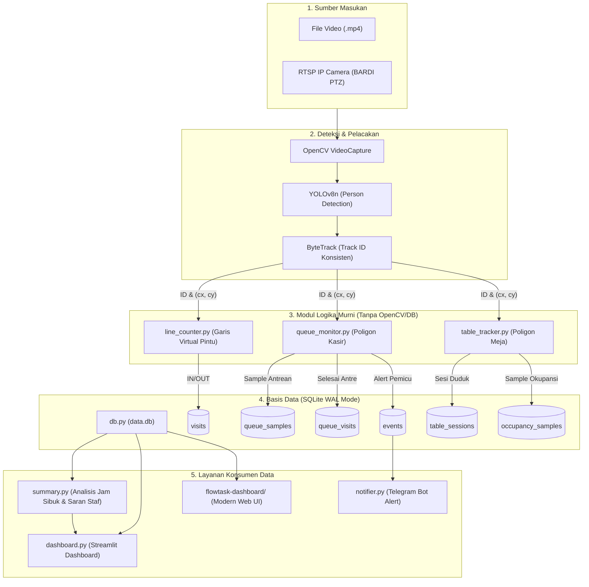

# Arsitektur & Desain Sistem (VisionCCTV)

Dokumen ini mendokumentasikan arsitektur teknis, alur data, dan keputusan desain yang mendasari sistem **VisionCCTV**.

---

## 1. Diagram Alur Data (*Data Pipeline Flow*)

---

## 2. Keputusan Desain Utama (*Design Decisions*)

### A. Pemisahan Logika Murni (*Pure Logic Architecture*)
Modul [line_counter.py](file:///C:/Users/ryan/.vscode/Project_CCTV_Deteksi_Orang/line_counter.py), [queue_monitor.py](file:///C:/Users/ryan/.vscode/Project_CCTV_Deteksi_Orang/queue_monitor.py), [table_tracker.py](file:///C:/Users/ryan/.vscode/Project_CCTV_Deteksi_Orang/table_tracker.py), dan [summary.py](file:///C:/Users/ryan/.vscode/Project_CCTV_Deteksi_Orang/summary.py) didesain sebagai **logika murni**:
- **Dilarang keras mengimpor OpenCV, Ultralytics, PyTorch, atau SQLite**.
- Masukan murni berupa koordinat piksel `(cx, cy)`, ID pelacak `track_id`, dan waktu `now` (dalam detik).
- **Keuntungan**:
  1. Pengujian unit sangat cepat (35 unit test selesai dalam < 0.2 detik tanpa beban inisialisasi AI/GPU).
  2. Modul logika dapat diuji secara independen tanpa bergantung pada keberadaan kamera fisik atau file video.

### B. Konsep Ambang Batas Waktu Tinggal (*Min Dwell Time*)
Untuk mencegah kesalahan pencatatan (*false positive*):
- Pada zona antrean kasir: seseorang harus berada di zona minimal `queue_min_dwell_sec` (misal 5 detik) agar dicatat sebagai pengantre ke `queue_visits`.
- Pada meja pengunjung: seseorang harus berada di meja minimal `table_min_dwell_sec` (misal 30 detik) agar status meja berubah ke `TERISI` dan sesi dicatat ke `table_sessions`. Orang yang sekadar melintas tidak akan dicatat.

### C. Toleransi Deteksi Hilang (*Grace Period*)
Deteksi kamera sering mengalami kedipan (*flickering*) atau tertutup sesaat oleh objek lain (*occlusion*):
- `lost_grace_sec` (kasir) dan `leave_grace_sec` (meja) memastikan ID yang hilang sesaat tidak langsung dianggap pergi, sehingga durasi tunggu atau sesi duduk tidak terpotong-potong.

### D. Basis Data SQLite dengan Mode WAL
- Database menggunakan `PRAGMA journal_mode=WAL` (Write-Ahead Logging).
- Hal ini memungkinkan [monitor.py](file:///C:/Users/ryan/.vscode/Project_CCTV_Deteksi_Orang/monitor.py) menulis data secara *real-time* sementara [dashboard.py](file:///C:/Users/ryan/.vscode/Project_CCTV_Deteksi_Orang/dashboard.py) membaca data secara bersamaan tanpa terjadinya *error* `database is locked`.
